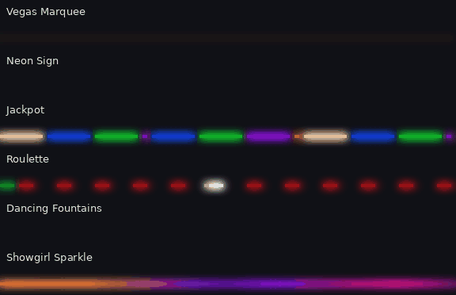

# Coastal FX — custom WLED effects

Seventeen custom effects compiled into WLED 16.0.1 for the WeGoIOT ESP32 box (keeps the microphone / AudioReactive support).

| Effect | What it does | Controls |
|---|---|---|
| Holiday Bulbs | Alternating bulbs in colors 1/2/3, chase or still | Chase speed (0 = still), Bulb size, Smooth |
| Holiday Twinkle | Alternating bulbs with warm-white sparkles | Fade speed, Sparkles, Bulb size |
| Candy Cane | Moving stripes in colors 1/2 | Speed, Stripe width |
| Retro C9 | Classic red/green/blue/orange/gold bulbs, soft flicker | Flicker, Bulb size |
| Fireworks Burst | Bursts expanding and fading in colors 1/2/3 | Launch rate, Burst size, Trail fade |
| Ocean Swell | Rolling blue/teal waves with whitecaps | Wave speed, Whitecaps |
| Lightning Storm | Dim clouds, multi-flash strikes | Strike rate, Flash size, Cloud glow |
| Sunrise | Night → red → amber → warm white | Minutes (1–64), Sunset (reverse) |
| Boom Fireworks 🎵 | Listens to the mic: real bangs launch bursts sized by loudness; big booms flash and crackle | Sensitivity, Burst size, Fade, Cooldown, Big-boom flash, Show mic level |
| Pool Shimmer | Sunlight-through-water caustics: thin bright ribbons drifting and crossing over pool blue | Speed, Sparkle, Ripple size, Warm sun |
| Northern Lights | Aurora curtains folding over a night sky: green cores, purple fringes, fine rays, slow surges | Speed, Activity, Curtain size, Stars |

### Las Vegas (ids 231–236)

| Effect | What it does | Controls |
|---|---|---|
| Vegas Marquee | Casino-sign bulbs: a three-circuit chaser (two on, one off), and with Show changes up it runs a sign's routine — chase, chase back, alternate blink, fill and empty, flash, sparkle. Filament glow makes bulbs warm up and cool down like real incandescents | Chase speed, Bulb spacing, Show changes (0 = chase only), Filament glow, My colors (1 bulbs, 2 background, 3 flash) |
| Neon Sign | Neon tubes in pink, blue, red-orange, lime, violet and turquoise with a faint buzz. They stutter on at start; Animation lights them one by one, holds, blinks three times and goes dark like an animated sign. Faulty tubes flicker now and then | Animation (0 = always on), Tube length, Faulty tubes, My colors |
| Jackpot | Slot machine: the strip becomes reels of colored symbols that spin and stop one after another with a bounce. Three of a kind strobes gold, then gold chases the whole strip with sparkling coins | Pace, Jackpot odds, Reels (3–7) |
| Roulette | Red and black pockets (green zero every 37) turning one way while a white ball races the other, slows, rattles over a few pockets and settles. The winning pocket flashes and its color lights up | Spin speed, Pocket size, My colors (1 red, 2 black, 3 zero) |
| Dancing Fountains 🎵 | A fountain show: rolling waves, bursts together, call-and-response, rapid shooters and a finale. Jets leap and fall with gravity, leave mist and sparkle at the crown. *Dance to music* makes each jet follow its own slice of the music (mic) | Tempo, Jets, Jet height, Dance to music, My colors (1 water, 2 lights) |
| Showgirl Sparkle | Soft plumes of hot pink, gold and violet swaying along the strip, covered in glinting sequins; a spotlight sweeps across now and then and the sequins flash in a wave | Shimmer, Sequins, Feather size, My colors |

The Vegas effects use their own colors, so each one looks right the moment it's picked whatever
the strip was showing before. Tick **My colors** to use color slots 1–3 instead (black slots are skipped).

If a color slot is black the effect uses a default (red/green for the holiday effects,
red/white/blue for fireworks, blue/teal for the ocean).

Effect IDs on this build: **220–236** in the order above. The WLED Info page shows
"Coastal FX: ids 220-236" when the firmware is running.

## Build (GitHub, no software to install)

1. Create a new **private** repository on github.com, e.g. `coastal-wled-fx`.
2. Upload everything in this folder, keeping the folder structure:
   - `usermods/coastal_fx/coastal_fx.cpp`
   - `usermods/coastal_fx/library.json`
   - `platformio_override.ini`
   - `.github/workflows/build.yml`
   Tip: the web uploader can skip the hidden `.github` folder. If it does, use
   **Add file → Create new file**, type `.github/workflows/build.yml` as the name,
   and paste the contents.
3. Open the **Actions** tab. "Build Coastal FX firmware" runs on every upload
   (or press **Run workflow**). It takes about 10 minutes the first time.
4. Open the finished run and download **Coastal-FX-firmware** (a zip). Inside is
   `Coastal-FX_WLED-16.0.1_ESP32.bin`.

## Install on the board (over Wi-Fi)

1. **Back up first:** WLED → Config → Security & Updates → *Backup presets* and *Backup configuration*.
2. Config → Security & Updates → **Manual OTA update** → choose the `.bin` → Update.
   Leave "Ignore firmware validation" unchecked; this build uses the same release name (ESP32) as the board.
3. The board reboots in about 30 s. Settings and presets are kept.
4. Check Info: version 16.0.1 and "Coastal FX: ids 220-236".
5. Config → LED Preferences → **White management: Dual** (not Accurate). Accurate mode
   overwrites the warm-white channel these effects (and the Warm White preset) use.
6. Restore `presets.json` from this folder (Config → Security & Updates → Restore presets)
   for the holiday presets (30–46), the Vegas scenes (70–77) and the *Vegas Night* playlist (79),
   plus the everyday ones. This replaces the board's preset list, so if you've saved new presets
   since, merge them first. (The Home app can add just the Vegas scenes without touching the rest:
   Lights → the strip → Scenes → **Add Vegas scenes**.)

## Changing an effect

Edit `coastal_fx.cpp` on GitHub, commit, wait for the build, and OTA the new `.bin`.
Add new effects at the **end** of `setup()` so existing IDs (and presets) don't shift.
If you later move to a newer WLED version, change `WLED_VERSION` in the workflow — the
IDs may shift if that version adds built-in effects (the Info page will show the new range).

## Tuning Boom Fireworks

The mic is inside the sealed box, so test with real bangs (or a loud clap near the box):
1. In WLED → Config → Usermods → AudioReactive: make sure it's enabled, **AGC off**, Squelch around 10.
2. Pick Boom Fireworks and tick **Show mic level**. The first 30 pixels become a meter:
   green = current loudness, the red pixel = where it triggers.
3. Raise **Sensitivity** until the red pixel sits a little above the green bar's normal
   background (traffic, wind, music) but well below a bang.
4. Raise **Cooldown** if one boom fires twice (echoes); lower it for rapid finales.
5. Untick Show mic level. Pick any palette (Rainbow default; "Red & Blue" for the 4th).
Without the mic module it launches random fireworks instead of going dark.
